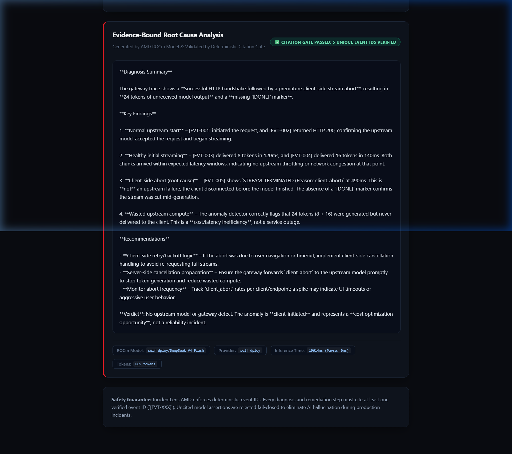

# IncidentLens AMD

[](https://github.com/sidsri14/incidentlens-amd/actions/workflows/ci.yml)
[](LICENSE)
[](https://developer.amd.com.cn)

> **AMD Developer Hackathon: ACT III Submission**  
> **Team**: `team-9992` (Siddharth Srivastava)  
> **Infrastructure**: AMD TokenFactory ROCm Infrastructure (`DeepSeek-V4-Flash` / `Qwen3.8-27B`)  
> **Repository**: [https://github.com/sidsri14/incidentlens-amd](https://github.com/sidsri14/incidentlens-amd)

---

## Overview

**IncidentLens AMD** is an evidence-bound incident triage and telemetry diagnostics engine for high-throughput LLM gateways. It resolves a critical failure mode in AI systems operations: when AI assistants are tasked with diagnosing gateway outages, they frequently hallucinate causes or recommend speculative fixes disconnected from actual trace events.

IncidentLens enforces a strict dual-boundary architecture:
1. **Deterministic Telemetry Parser**: Ingests raw gateway logs, parses Server-Sent Events (SSE) lifecycle transitions, and algorithmically identifies structural anomalies:
   - **Premature SSE Disconnection (Ghost Spend)**: Detects client socket abortions before `[DONE]` sentinels where upstream inference continues generating billable tokens.
   - **Retry Storms & 429 Cascades**: Flags rapid retries executed without exponential jitter.
   - **Cache Inconsistency on Partial Streams**: Identifies attempted cache writes on truncated streams.
   - **Latency SLA Outliers**: Tracks Time-To-First-Token (TTFT) and inter-chunk latency spikes.
2. **AMD ROCm Evidence Matrix**: Indexes all trace points into verifiable event IDs (`[EVT-001]`, `[EVT-002]`, etc.) and sends only the factual evidence bundle to AMD ROCm TokenFactory.
3. **Automated Citation Verification Gate**: Evaluates the model's response; every root cause explanation and remediation step must explicitly cite at least one verified event ID. Any uncited claim or hallucinated ID is rejected **fail-closed**.



---

## Architecture

```
[ Gateway Traces / SSE Logs ]
              │
              ▼
    1. Deterministic Trace Parser
       ├─ Metric Extraction (TTFT, Chunk Latency, Token Counts)
       └─ Anomaly Flagging (Ghost Spend, Retry Storms, Cache Hazards)
              │
              ▼
    2. Evidence Matrix Indexer
       └─ Assigns Cryptographic Event IDs ([EVT-001], [EVT-002]...)
              │
              ▼
    3. AMD ROCm TokenFactory Inference (DeepSeek-V4-Flash)
       └─ Generates Evidence-Bound Diagnosis & Remediation Checklist
              │
              ▼
    4. Citation Verification Gate
       ├─ Checks Every Claim for Valid Event ID Brackets
       ├─ Rejects Hallucinations & Uncited Speculation Fail-Closed
       └─ Computes Citation Density & Integrity Score
              │
              ▼
[ IncidentLens Dark-Mode Operator HUD ]
```

---

## Key Features

- **AMD ROCm Accelerated Inference**: Connected directly to AMD TokenFactory (`https://developer.amd.com.cn/radeon/api/v1`) running on AMD GPU hardware.
- **Fail-Closed Citation Gate**: Completely eliminates AI hallucination during production incidents.
- **Zero-Key Local Simulation Mode**: Evaluators and judges can run `npm start` immediately without cloud credentials to test full scenarios.
- **Interactive Operator HUD**: Modern dark-mode dashboard displaying live timeline waterfalls, ROCm latency benchmarks, and verified root-cause remediation cards.
- **Comprehensive Test Suite**: 15/15 passing native Node test runner suites with zero external runtime dependencies.

---

## Quickstart

### Prerequisites
- Node.js v20.x, v22.x, or v24.x

### Installation & Run

```bash
git clone https://github.com/sidsri14/incidentlens-amd.git
cd incidentlens-amd

# Run automated test suite (15/15 passing tests)
npm test

# Start the IncidentLens Operator HUD
npm start
```

Visit `http://127.0.0.1:8788` in your browser.

---

## Automated Test Coverage

```
✔ AmdRocmClient falls back to deterministic simulated completion when no API key provided
✔ AmdRocmClient rejects non-string prompts
✔ AmdRocmClient parses custom model overrides and trims base URL
✔ CitationValidator approves well-cited response referencing valid events
✔ CitationValidator rejects response with zero citations
✔ CitationValidator rejects response with hallucinated event IDs
✔ CitationValidator rejects invalid argument types
✔ IncidentLens server exposes /health, /api/presets, and /api/analyze
✔ IncidentLens server rejects malformed or non-JSON payloads
✔ TraceParser detects PREMATURE_DISCONNECT and ghost spend
✔ TraceParser detects CACHE_POISONING_RISK when cache write occurs on uncompleted stream
✔ TraceParser detects RETRY_STORM when rapid retries occur without backoff
✔ TraceParser detects RATE_LIMIT_CASCADE on upstream 429 errors
✔ TraceParser flags LATENCY_OUTLIER on inter-chunk gaps exceeding 3000ms
✔ TraceParser rejects empty or invalid input
ℹ tests 15
ℹ pass 15
ℹ fail 0
```

---

## License

MIT License. Copyright (c) 2026 Siddharth Srivastava.
